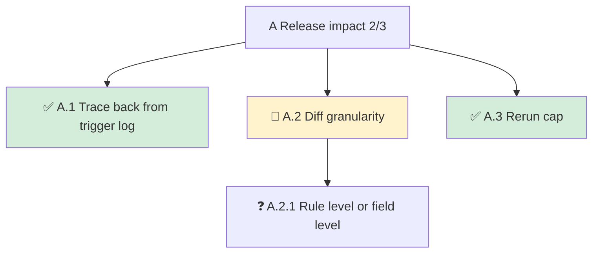

# problem-tree

**A handoff note that replaces `/compact`. Claude keeps one file per topic, with a live problem tree on top and the reasons underneath.**

A Claude Code skill for work that outlives one context window. From brainstorming through implementation, Claude maintains `docs/superpowers/handoff/<topic>.md`: where you are, what is solved, what waits on you, which decisions hold and why, and which pitfalls you already paid for. After `/clear`, say "continue" and the next session picks up from the file alone.

Since v0.2 the skill inside this plugin is called **devnote**: the problem tree is still on top, and the note now lasts through implementation. [中文說明](#中文說明)



## Why

`/compact` is a black box. It decides what to keep, and the things it drops are usually the ones that cost the most to rediscover: why an option was rejected, which fix did not work, what is a decision versus only a proposal. devnote makes Claude write those down as they happen, in a file you can read, diff and correct.

## How the file is built

Each handoff file has two halves with opposite rules.

| Part | Rule | Answers |
|---|---|---|
| **SNAPSHOT** (top) | Overwritten in full on every update. Only what is true now. | "Where are we?" |
| **HISTORY** (bottom) | One block per session. Append only, never edited. | "Why is it this way?" |

The SNAPSHOT holds, in order:

1. **Status line**: `Progress 2/3 ｜ Now: A.2 Diff granularity ｜ Next: wait for PM to settle the level`. "Next" must be an action, not a topic name.
2. **Mermaid problem tree**: the single source of requirement status.
3. **Open questions**: ❓ needs your decision (as a question, with a proposal), ⏸ blocked (on whom).
4. **Solved & key decisions**: one line each, pointing to the HISTORY timestamp that has the reasoning.
5. **Known pitfalls**: things that will bite again.

Each HISTORY block records what was done, decisions in full (what, why, what was rejected, impact) and failures in full (what was tried, the final fix, the root cause).

### Node states

| State | Marker | Fill | Text goes in |
|---|---|---|---|
| Solved | ✅ | `#d4edda` | Solved & key decisions |
| In progress | 🔶 | `#fff3cd` | the "Now" in the status line |
| Needs your decision | ❓ | none | Open questions |
| Blocked | ⏸ | none | Open questions |

## Design notes

- **Two halves, because "now" and "why" age differently.** A new session needs the current state in ten seconds, so the SNAPSHOT is rewritten and never accumulates. Reasons must not be rewritten, so HISTORY is append-only.
- **The tree replaces a checklist.** Keeping both means they drift. Emoji carry the state, so the tree still reads in a plain terminal.
- **Guardrails keep the tree honest.** One 🔶 at a time, depth of two, five children per parent, three roots per file, short node text. A sixth child is regrouped by theme into sibling roots, or merged if no clean split exists. Hitting the limits is a signal to write the design doc.
- **The tree freezes during implementation.** Plan tasks stay in the plan, which has its own checkboxes. Only new design questions add nodes.
- **Proposals are labelled.** Claude records only conclusions you stated. The next session treats the file as settled, so a wrong entry costs more than a missing one.
- **Small on purpose.** A "classify before writing" table tells Claude what not to write. A fat file does not get read.

## Install

```
/plugin marketplace add JimmyTsai55/problem-tree
/plugin install problem-tree
```

Or only the skill, without the Stop hook:

```
git clone https://github.com/JimmyTsai55/problem-tree ~/.claude/skills/problem-tree-src
ln -s ~/.claude/skills/problem-tree-src/skills/devnote ~/.claude/skills/devnote
```

Then paste [`docs/CLAUDE.md.snippet`](docs/CLAUDE.md.snippet) into your project or global `CLAUDE.md`, so Claude checks for unfinished files at session start. Restart Claude Code.

The shipped skill is written in Traditional Chinese with bilingual triggers, and it writes notes in your language. An English translation is in [`docs/SKILL.en.md`](docs/SKILL.en.md); copy it over `skills/devnote/SKILL.md` if you prefer English instructions.

## Daily use

| Situation | Say |
|---|---|
| A sub-problem comes up | `add sub-problem A.2: <one line>` |
| Start working on one | `go to A.2` |
| Reached a conclusion | `A.2 solved: <conclusion>` |
| Check status | `tree` or `where are we` |
| End of day, or context is full | `wrap up`, then `/clear` |
| Next session | `continue` |
| Topic is finished | `close topic` |

After each update Claude replies with one line: `Progress n/m ｜ Now: X ｜ Next: …`

## Lifecycle

1. **Brainstorming**: the tree grows as sub-problems appear and resolve.
2. **Design doc written**: the tree and key decisions are pasted at the top of the doc. The handoff file stays in use.
3. **Implementation**: solved pitfalls go to HISTORY, recurring ones to Known pitfalls.
4. **Closed**: when you say so, or all nodes are ✅ and the plan is done, the file moves to `docs/superpowers/handoff/done/`.

## Seeing the diagram

- **Cursor / VS Code**: install *Markdown Preview Mermaid Support*, then `Cmd+Shift+V`. Pin the preview beside the chat.
- **GitHub / GitLab / Obsidian**: native.

## Stop hook

The plugin ships a `Stop` prompt hook. When a handoff file is in use and something noteworthy happened, it checks the file is current before Claude stops. A prompt hook must explicitly return `ok:true` for the not-applicable case, otherwise the judge's explanation is read as a block and Claude cannot stop.

## Upgrading from v0.1

| | v0.1 (problem-tree skill) | v0.2 (devnote skill) |
|---|---|---|
| Lifetime | Brainstorming only | Brainstorming through implementation |
| File | Status line, tree, three lists | SNAPSHOT with tree, plus HISTORY |
| Reasons and pitfalls | Not recorded | Recorded in HISTORY |
| Ends when | Design doc is written | Topic is closed |

The skill was renamed from `problem-tree` to `devnote`, so replace the old lines in your `CLAUDE.md` with the new [`docs/CLAUDE.md.snippet`](docs/CLAUDE.md.snippet). Existing handoff files keep working: the tree and status line are unchanged, and Claude adds the SNAPSHOT and HISTORY headings on the next update.

## License

MIT

---

# 中文說明

**取代 `/compact` 的交接筆記。Claude 每個 topic 維護一個檔，上面是即時的問題樹，下面是來龍去脈。**

給會跨過一個 context window 的工作用的 Claude Code skill。從 brainstorming 到實作結束，Claude 持續維護 `docs/superpowers/handoff/<topic>.md`：現在在哪、哪些解決了、哪些等你拍板、哪些決策仍然成立以及為什麼、哪些坑已經踩過。`/clear` 之後說「繼續」，下個 session 只讀這個檔就能接手。

v0.2 起，這個 plugin 裡的 skill 改名為 **devnote**：問題樹還在最上面，筆記則一路用到實作結束。

## 為什麼

`/compact` 是黑箱。留什麼由它決定，而被丟掉的通常是重新找回來最貴的東西：某個選項為什麼被否決、哪個解法試過沒用、哪些是結論哪些只是提案。devnote 讓 Claude 在事情發生當下就寫下來，寫在一個你能讀、能 diff、能改的檔裡。

## 檔案怎麼組成

每個 handoff 檔分兩半，規則相反。

| 區塊 | 規則 | 回答 |
|---|---|---|
| **SNAPSHOT**（檔頂） | 每次整段覆寫，只放現在成立的事 | 「現在在哪？」 |
| **HISTORY**（檔尾） | 一個 session 一塊，只增不改 | 「為什麼變這樣？」 |

SNAPSHOT 依序放：

1. **狀態列**：`進度 2/3 ｜ 現在：A.2 差異粒度 ｜ 下一步：等 PM 拍板粒度層級`。「下一步」必須是動作，不是題目名稱。
2. **Mermaid 問題樹**：需求狀態的唯一來源。
3. **未解問題**：❓ 等你決定（寫成問句、附提案），⏸ 被擋住（寫等誰）。
4. **已解決與關鍵決策**：一條一行，指回 HISTORY 的時間戳，理由在那裡。
5. **已知地雷**：會再踩的坑。

HISTORY 每塊記錄做了什麼、完整的決策（內容、理由、否決了什麼、影響）、完整的填坑經過（試過什麼無效、最終解法、根因）。

### 節點狀態

| 狀態 | 標記 | 顏色 | 文字寫在哪 |
|---|---|---|---|
| 已解決 | ✅ | `#d4edda` | 已解決與關鍵決策 |
| 正在處理 | 🔶 | `#fff3cd` | 狀態列的「現在」 |
| 等你拍板 | ❓ | 不上色 | 未解問題 |
| 被擋住 | ⏸ | 不上色 | 未解問題 |

## 設計解說

- **分兩半，因為「現在」和「為什麼」的保存方式不同。** 新 session 要在十秒內知道現況，所以 SNAPSHOT 每次重寫、不累積。理由不能被改寫，所以 HISTORY 只增不改。
- **用樹取代勾選清單。** 兩份並存一定會不同步。狀態由 emoji 表達，純終端機也讀得出來。
- **護欄讓樹保持誠實。** 同時只有一個 🔶、深度兩層、一父最多五子、一檔最多三個根、節點文字要短。第六個子節點出現時依主題重新分成同層的根，分不乾淨就合併。撞到上限代表該寫設計文件了。
- **實作期樹凍結。** plan 的 task 留在 plan 裡，它自己有勾選。只有新的設計問題才加節點。
- **提案要標示。** Claude 只記你說過的結論。下個 session 會把檔裡的內容當定案照做，記錯一條比漏記一條更糟。
- **刻意保持精簡。** 「寫之前先分類」的表告訴 Claude 什麼不用寫。檔案一肥就沒人讀。

## 安裝

```
/plugin marketplace add JimmyTsai55/problem-tree
/plugin install problem-tree
```

只裝 skill、不要 Stop hook：

```
git clone https://github.com/JimmyTsai55/problem-tree ~/.claude/skills/problem-tree-src
ln -s ~/.claude/skills/problem-tree-src/skills/devnote ~/.claude/skills/devnote
```

再把 [`docs/CLAUDE.md.snippet`](docs/CLAUDE.md.snippet) 貼進專案或全域 `CLAUDE.md`，讓 Claude 在 session 開頭檢查有沒有未完成的檔。重開 Claude Code。

內建的 skill 以繁體中文撰寫、觸發詞中英並列，筆記會用你的語言寫。英文譯本在 [`docs/SKILL.en.md`](docs/SKILL.en.md)。

## 日常用法

| 情境 | 說 |
|---|---|
| 子問題冒出來 | `加子問題 A.2：〈一句話〉` |
| 決定處理某個 | `進 A.2` |
| 有結論 | `A.2 解決了：〈結論〉` |
| 看狀態 | `樹` 或 `現在在哪` |
| 收工或 context 快滿 | `收工`，然後 `/clear` |
| 下個 session | `繼續` |
| 題目做完 | `結案` |

每次更新 Claude 只回一行：`進度 n/m｜現在 X｜下一步：…`

## 生命週期

1. **Brainstorming**：子問題出現和解決，樹跟著長。
2. **設計文件寫出**：樹和關鍵決策貼到設計文件開頭，handoff 檔繼續用。
3. **實作**：解掉的坑進 HISTORY，會再踩的進已知地雷。
4. **結案**：你說結案，或節點全 ✅ 且 plan 做完，檔移到 `docs/superpowers/handoff/done/`。

## 看圖

- **Cursor / VS Code**：裝 *Markdown Preview Mermaid Support*，`Cmd+Shift+V`，把預覽釘在對話旁邊。
- **GitHub / GitLab / Obsidian**：原生支援。

## Stop hook

plugin 附一個 `Stop` prompt hook：有 handoff 檔在用、而且發生了值得記的事時，Claude 停下前會確認檔是最新的。prompt hook 必須明示「不適用時回 ok:true」，否則判斷模型的說明會被當成 block，Claude 停不下來。

## 從 v0.1 升級

| | v0.1（problem-tree skill） | v0.2（devnote skill） |
|---|---|---|
| 使用期間 | 只有 brainstorming | brainstorming 到實作結束 |
| 檔案 | 狀態列、樹、三張清單 | 含樹的 SNAPSHOT，加上 HISTORY |
| 理由與踩坑 | 不記 | 記在 HISTORY |
| 何時結束 | 設計文件寫出 | 結案 |

skill 從 `problem-tree` 改名為 `devnote`，請把 `CLAUDE.md` 裡的舊規則換成新的 [`docs/CLAUDE.md.snippet`](docs/CLAUDE.md.snippet)。既有的 handoff 檔可以繼續用：樹和狀態列格式不變，Claude 下次更新時會補上 SNAPSHOT 和 HISTORY 標題。

## 授權

MIT
