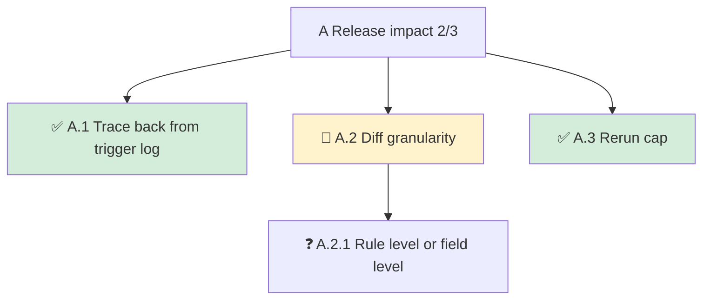

# devnote

One file per topic: `docs/superpowers/handoff/<topic>.md`, used from brainstorming until implementation is finished. It replaces `/compact`: rather than letting the conversation be compressed in a black box that loses detail, write down what actually matters (the problem tree, decisions, pitfalls, open questions) so the next session can take over by reading this file alone.

- **SNAPSHOT (top of file)**: overwritten in full on every update; holds only what is true now. To know "now", read only this.
- **HISTORY (bottom of file)**: one block per session, increments only, older blocks never edited. Read further down only to learn "why".

## Format

````markdown
# Release impact assessment

## 📌 SNAPSHOT

**Progress 2/3 ｜ Now: A.2 Diff granularity ｜ Next: wait for PM to settle the granularity level**
**Done when**: affected trigger records can be listed before a release, within 5% sampling error
**Last updated**: 2026-10-14 15:30
**Docs**: design docs/superpowers/specs/<file> ｜ plan docs/superpowers/plans/<file> (add once written)



### Open questions
- ❓ A.2.1 Rule level or field level? Waiting on PM; proposal: proceed at rule level for now
- ⏸ (none)

### Solved & key decisions (currently valid)
- **A.1 Trace back from the existing trigger log**: 19 of 20 sampled records matched (HISTORY [2026-10-10 14:20])
- **A.3 Cap reruns at 500 records**: more than that stalls the scheduler (HISTORY [2026-10-10 14:20])

### Known pitfalls
- **Time columns**: the old table stores local time; convert to UTC before comparing (HISTORY [2026-10-10 14:20])

---

# 📜 HISTORY

## [2026-10-10 14:20] Trace-back feasibility and rerun cap

### What was done
Confirmed the trigger log can be traced back; set the rerun cap.

### Major technical decisions
- **A.1 Trace back from the existing trigger log**
  - What: derive release impact directly from the trigger log
  - Why: 19 of 20 sampled records matched; rejected a separate mapping table (one more dataset to keep in sync)
  - Impact: no new table needed

### Failures and fixes
- **Sampled timestamps were all off by 8 hours**
  - Tried, no effect: changing the query timezone parameter (the data was written without a timezone)
  - Final fix: convert to UTC before comparing
  - Root cause: the old table stores local time, the new one stores UTC
````

### Status line (first line of SNAPSHOT, the most important)
`**Progress solved/child-nodes ｜ Now: X name ｜ Next: who does what**`
"Next" is one sentence someone can act on immediately, not the name of a problem; after `/clear` no context is left to fill in a vague next step. During implementation, "Now" is the plan task.

### Done when (the line under the status line)
One verifiable completion condition that answers "what counts as done". devnote only records it and does not lead the discussion:
- If the user has already confirmed success criteria (for example while clarifying purpose in brainstorming), copy them; do not ask again.
- If there is none when the file is created, ask one question: "What counts as done?" If the user does not answer, write "not set" and carry on. Write your own idea as "not set (proposal: …)".
- When the goal changes: SNAPSHOT keeps only the current version; HISTORY records what changed and why.

### Node markers (emoji + color, readable as plain text too)
| State | Emoji | Color | Where the text goes |
|---|---|---|---|
| Solved | ✅ | `fill:#d4edda` | Solved & key decisions (one-line conclusion, pointing to HISTORY) |
| In progress | 🔶 | `fill:#fff3cd` | It is the "Now" in the status line |
| Needs the user's decision | ❓ | none | Open questions (as a question, with a proposal) |
| Blocked by a prerequisite | ⏸ | none | Open questions (say who it waits on) |

There is no fifth state. The diagram is the single source of requirement status; do not keep a separate checklist, because two copies always drift apart.

## Classify before writing

Compare the current SNAPSHOT with what happened this time and decide where each item goes:

| Situation | SNAPSHOT | HISTORY |
|---|---|---|
| Brand-new information | Add | Record |
| Existing node progressed (🔶→✅ etc.) | Update diagram and status line | One sentence |
| Already recorded, unchanged | Leave | Nothing |
| New decision or newly hit pitfall | One-line conclusion or reminder only | In full: reason, what was rejected, root cause |

Prefer short and precise over padded and repeated. For a small-fix session, one or two HISTORY lines are enough; once the file gets fat, the next session cannot finish reading it.

## Rules

### Tree
- Exactly one 🔶 at a time. If the user wants a second one open, remind them to close one first.
- Depth is at most two levels (A → A.1 → A.1.1). If a third level is needed, remind the user to go back to the parent.
- At most five children per parent. When a sixth appears, first see whether the six split into two groups by theme; if so, split into two **sibling roots** A and B, renumber B's children, and count progress separately. If they do not split cleanly, the sub-problems are cut too fine: merge the similar ones instead of forcing a split. At most three roots per file; beyond that it is time to write the design doc.
- Node text is 15 characters or fewer in Chinese (about 5 words in English) and states only the problem. Reasons, data and options go in the lists and HISTORY, not the diagram.
- When a sub-problem is solved: mark the node ✅, add a one-line conclusion to "Solved & key decisions", move the current position back to the parent, update the progress count. When all children are ✅, the parent becomes ✅ too.
- Goal met but unsolved nodes remain: once the user confirms they are dropped, delete those nodes from the tree, recount progress, and add one HISTORY line ("goal met, A.4 dropped"). There is no "dropped" state; the tree holds only what still stands.
- The tree stops growing during implementation: plan tasks are not copied in, since the plan has its own checkboxes. Add a node only when a new design question surfaces.

### Notes
- Overwrite the whole SNAPSHOT on every update; get "Last updated" from `date "+%Y-%m-%d %H:%M"`.
- List only decisions and pitfalls that still hold; delete overturned ones. Each line points back to a HISTORY timestamp.
- HISTORY: open a block the first time this session has content, then append everything from this session to it; never edit earlier blocks, and delete empty subsections.
- Record only conclusions the user actually stated; label your own ideas "proposal". The next session will treat what is written here as settled, so one wrong entry is worse than one missing entry.
- Write in the user's language.
- After updating, reply with one line only: `Progress n/m ｜ Now: X ｜ Next: …`. The content is in the file; do not repeat it in chat.

## When to do what
- **Design doc written**: paste the Mermaid block and "Solved & key decisions" at the top of the design doc; keep using this file.
- **Implementation**: when a pitfall is solved, write it into HISTORY; if it could bite again, add it to Known pitfalls.
- **Wrap up / compact / switching sessions**: bring the file fully up to date and reply "Saved. After /clear, say 'continue' to pick up."
- **Continue**: read only the SNAPSHOT, read out the status line, and wait for the user to confirm before acting.
- **More than three unfinished files**: ask which one can be closed first.
- **Creating the file**: write down the "Done when" goal; ask one question if there is none.
- **Close topic**: when the user says so, or the goal is met and the plan is done, move the file to `docs/superpowers/handoff/done/`. If all nodes are ✅ but the goal is "not set" or not yet met, do not close automatically; ask the user first.
