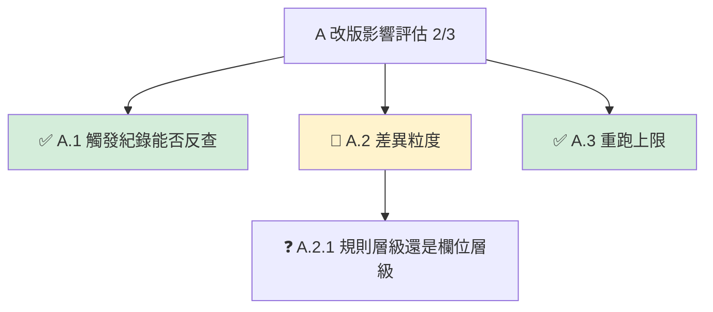

# devnote

每個 topic 一個檔：`docs/superpowers/handoff/<topic>.md`，從 brainstorming 用到實作結束。目的是取代 `/compact`：與其讓對話被黑箱壓縮、細節遺失，不如主動把真正重要的東西（問題樹、決策、坑、未解問題）寫下來，下個 session 只讀這個檔就能接手。

- **SNAPSHOT（檔頂）**：每次整段覆寫，只放現在成立的事。想知道「現在」只看這裡。
- **HISTORY（檔尾）**：一個 session 一塊，只寫增量，舊的不改。想知道「為什麼」才往下讀。

## 格式

````markdown
# 改版影響評估

## 📌 SNAPSHOT

**進度 2/3 ｜ 現在：A.2 差異粒度 ｜ 下一步：等 PM 拍板粒度層級**
**最後更新**：2026-10-14 15:30
**文件**：設計 docs/superpowers/specs/<檔名>｜plan docs/superpowers/plans/<檔名>（寫出後才加）



### 未解問題
- ❓ A.2.1 規則層級還是欄位層級？等 PM；提案：暫定規則層級往下做
- ⏸ （無）

### 已解決與關鍵決策（當前有效）
- **A.1 用既有觸發紀錄反查**：抽樣 20 筆有 19 筆對上（HISTORY [2026-10-10 14:20]）
- **A.3 重跑限 500 筆**：超過會卡排程（HISTORY [2026-10-10 14:20]）

### 已知地雷
- **時間欄位**：舊表存本地時間，比對前一律轉 UTC（HISTORY [2026-10-10 14:20]）

---

# 📜 HISTORY

## [2026-10-10 14:20] 反查可行性與重跑上限

### 本次做了什麼
確認觸發紀錄可反查，定出重跑上限。

### 本次重大技術決策
- **A.1 用既有觸發紀錄反查**
  - 內容：改版影響直接從觸發紀錄反查
  - 理由：抽樣 20 筆有 19 筆對上；否決另建對照表（多一份要同步的資料）
  - 影響：不用新增資料表

### 本次失敗經驗與填坑
- **抽樣比對時間全差 8 小時**
  - 試過無效：改查詢時區參數（原因：寫入時就沒帶時區）
  - 最終解法：比對前一律轉 UTC
  - 根因：舊表存本地時間、新表存 UTC
````

### 狀態列（SNAPSHOT 第一行，最重要）
`**進度 已解決數/子節點數 ｜ 現在：X 名稱 ｜ 下一步：誰做什麼**`
「下一步」寫成能直接動手的一句話，不是問題名稱；`/clear` 之後沒有任何上下文能補足模糊的下一步。實作期「現在」寫 plan 的 task。

### 節點標記（emoji + 顏色，純文字也讀得出）
| 狀態 | emoji | 顏色 | 文字寫在哪 |
|---|---|---|---|
| 已解決 | ✅ | `fill:#d4edda` | 已解決與關鍵決策（結論一行，指回 HISTORY） |
| 正在處理 | 🔶 | `fill:#fff3cd` | 就是狀態列的「現在」 |
| 等使用者拍板 | ❓ | 不上色 | 未解問題（寫成問句，附提案） |
| 被前置擋住 | ⏸ | 不上色 | 未解問題（寫等誰） |

沒有第五種。圖是需求狀態的唯一來源，不另外列勾選清單，抄兩份一定會不同步。

## 寫之前先分類

對照現有 SNAPSHOT 和這次發生的事，決定每件事寫到哪裡：

| 情況 | SNAPSHOT | HISTORY |
|---|---|---|
| 全新資訊 | 新增 | 記錄 |
| 既有節點有進展（🔶→✅ 等） | 更新圖和狀態列 | 一句帶過 |
| 已記錄、沒變化 | 不動 | 不寫 |
| 新做的決策、新踩的坑 | 只放一行結論或提醒 | 寫完整：理由、否決了什麼、根因 |

寧可少寫精準，不要灌水重複。小修小補的 session，HISTORY 一兩行就夠；檔案一肥，下個 session 就讀不完。

## 規則

### 樹
- 🔶 永遠只有一個。使用者要同時開第二個，提醒先關一個。
- 深度最多兩層（A → A.1 → A.1.1）。要開第三層，提醒回到父節點。
- 一個父節點最多五個子節點。要開第六個時，先看能不能依主題分成兩群；能就拆成 A、B 兩個**同層的根**，B 的子節點重新編號，各自數進度。分不出兩群代表切太細，先合併相近的，不硬拆。一個檔最多三個根，超過就該寫設計文件了。
- 節點文字 15 字以內，只寫問題本身。理由、數據、選項不進圖，進清單和 HISTORY。
- 子問題解決時：節點改 ✅、結論一行寫進「已解決與關鍵決策」、目前位置彈回父節點、更新進度數字。所有子節點都 ✅，父節點也改 ✅。
- 實作期樹不再長：plan 的 task 不抄進來，plan 自己有勾選。實作中冒出新的設計問題才加節點。

### 筆記
- 每次更新都覆寫整段 SNAPSHOT，「最後更新」用 `date "+%Y-%m-%d %H:%M"`。
- 決策、地雷只列仍然成立的，被推翻的刪掉；每條指回 HISTORY 時間戳。
- HISTORY：本 session 第一次有內容時開一塊，之後本 session 的事都補進這塊；之前的塊不改，沒內容的子節刪掉。
- 只記使用者說過的結論，自己的提案標「提案」。下個 session 會把這裡寫的當定案照做，記錯一條比漏記一條更糟。
- 用使用者的語言。英文對應：`Progress n/m ｜ Now: X ｜ Next: …`；`Open questions` / `Solved & key decisions` / `Known pitfalls`。
- 更新後只回一行：`進度 n/m｜現在 X｜下一步：…`，內容已在檔裡，不用在對話重述。

## 什麼時候做什麼
- **設計文件寫出**：把 mermaid 區塊和「已解決與關鍵決策」貼到設計文件開頭，這個檔繼續用。
- **實作**：坑解掉就寫進 HISTORY，會再踩的加進已知地雷。
- **收工／compact／換 session**：把檔寫完整，回「已存檔，/clear 後說『繼續』即可接手」。
- **繼續**：只看 SNAPSHOT，念狀態列，等使用者確認再動。
- **未完成的檔超過三個**：多問一句，哪一個可以先結案。
- **結案**：使用者說結案，或節點全 ✅ 且 plan 做完，就移到 `docs/superpowers/handoff/done/`。
